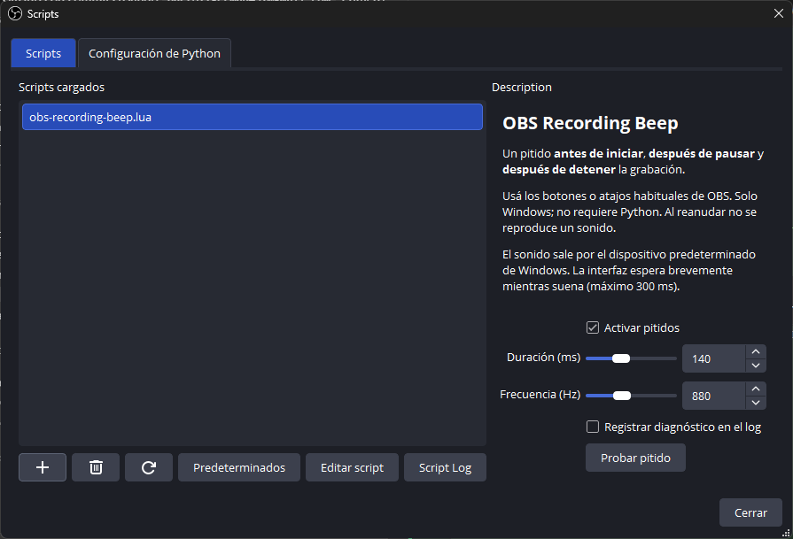
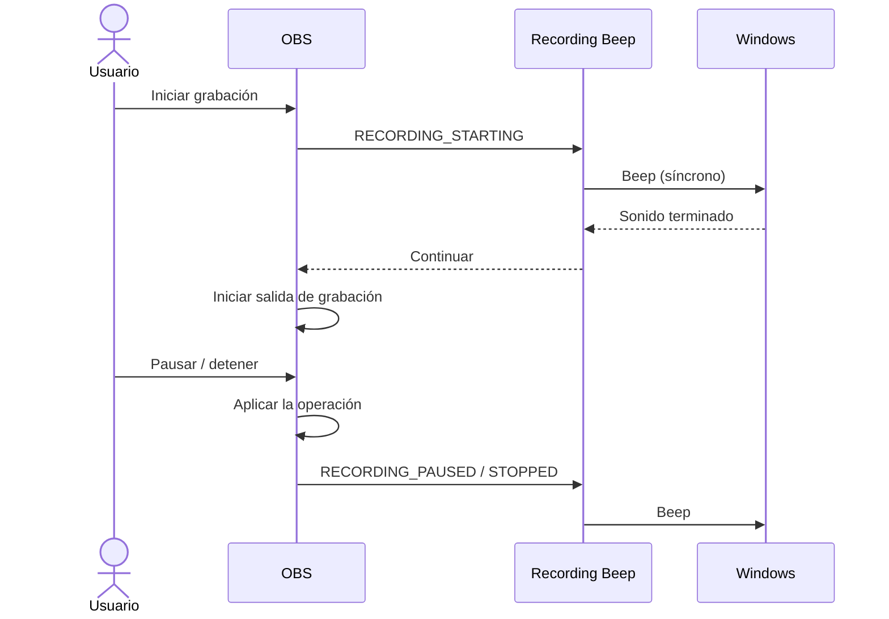

# OBS Recording Beep

**Escuchá cuándo empieza, se pausa, se reanuda y termina tu grabación.**

[](https://github.com/GermanBartoli/obs-recording-beep/actions/workflows/tests.yml)


Complemento liviano para **OBS Studio en Windows**, implementado como un script Lua. Funciona con los botones y atajos de grabación que ya usás: no agrega controles paralelos, no necesita Python y no requiere compilar una DLL.



## Qué hace

| Acción en OBS | Orden del aviso |
| --- | --- |
| Iniciar grabación | 🔊 Pitido → inicio de la grabación |
| Pausar grabación | Pausa confirmada → 🔊 pitido |
| Detener grabación | Grabación detenida → 🔊 pitido |
| Reanudar grabación | Pausa breve de protección → 🔊 pitido → continuar grabando |

El aviso de inicio indica **un intento de inicio**, no garantiza que el codificador pueda grabar. Si OBS falla después, prevalece el error mostrado por OBS.

## Instalación rápida

1. Descargá el repositorio desde **Code → Download ZIP** y extraelo en una carpeta permanente.
2. Abrí OBS y entrá en **Herramientas → Scripts**.
3. Presioná **+** y seleccioná [`src/obs-recording-beep.lua`](src/obs-recording-beep.lua).
4. Presioná **Probar pitido** para comprobar el audio.
5. Cerrá la ventana de scripts y grabá con los controles habituales.

OBS conserva la ruta del script. No borres ni muevas esa carpeta después de instalarlo. Funciona también con la distribución de OBS de Steam. Cargalo una sola vez para evitar avisos duplicados.

## Configuración

Todos los ajustes se encuentran en **Herramientas → Scripts → obs-recording-beep.lua**.

| Opción | Valor inicial | Rango / función |
| --- | --- | --- |
| Activar pitidos | Activado | Silencia todos los avisos si se desactiva |
| Duración | 140 ms | Entre 50 y 300 ms |
| Frecuencia | 880 Hz | Entre 200 y 2000 Hz |
| Registrar diagnóstico en el log | Desactivado | Registra el estado de grabación y el resultado del pitido |
| Probar pitido | Botón | Reproduce el sonido con los ajustes actuales |

El audio usa el dispositivo de reproducción predeterminado de Windows mediante `Beep`. El volumen depende del sistema; el complemento no cambia el volumen ni los dispositivos.

## Compatibilidad y límites

- Diseñado para **Windows de 64 bits con OBS Studio y LuaJIT/FFI**. No compatible con macOS o Linux para reproducción real.
- El orden de inicio se verificó en el código de **OBS 32.2.2**; otras versiones deben validarse antes de asumir el mismo comportamiento.
- El pitido es síncrono: la interfaz espera durante el sonido, por defecto **140 ms** y como máximo **300 ms**. Al iniciar se agregan **350 ms** de margen antes de grabar.
- Al pausar se esperan **200 ms** antes del aviso. Si reanudás enseguida, se cancela ese aviso pendiente.
- OBS informa la reanudación después de ejecutarla. El complemento vuelve a pausar, espera la confirmación, reproduce el aviso y deja **350 ms** antes de continuar. La reanudación se demora brevemente y puede incluir un pequeño tramo previo a la pausa de protección.
- La pausa depende de que el modo de grabación de OBS permita pausar. No agrega pausa a una salida incompatible.
- No crea fuentes de audio ni modifica escenas, perfiles, codificadores o atajos.
- No aísla el sonido de la captura de audio del escritorio ni del micrófono. Aunque los avisos se emiten antes del inicio o después de la pausa/detención, los búferes, el eco o una transmisión simultánea pueden capturarlos. No garantiza que sean inaudibles en todas las salidas.
- El aviso de detención confirma que OBS detuvo la grabación; no significa que haya terminado una conversión automática de formato.

## Cómo funciona



Los eventos se atienden directamente con la API de OBS y temporizadores breves para coordinar los avisos; no hay procesos externos ni conexión a Internet. Si no está disponible el audio, el error se registra sin impedir que OBS continúe.

Si descargás el script durante la pausa de protección, se cancelan los temporizadores y la grabación queda pausada; podés reanudarla con el botón habitual.

## Estructura del proyecto

```text
obs-recording-beep/
├── src/obs-recording-beep.lua     # Complemento listo para instalar
├── tests/recording_beep_spec.lua  # Pruebas de comportamiento
├── tools/test_windows.py         # Pruebas con el LuaJIT de OBS
├── docs/VALIDACION.md            # Procedimiento y evidencia de validación
├── .github/workflows/tests.yml   # Integración continua
├── .editorconfig                # Convenciones de edición
├── .gitattributes               # Finales CRLF en el directorio de trabajo
├── CHANGELOG.md
├── CONTRIBUTING.md
└── LICENSE
```

## Desarrollo y pruebas

No hay paso de compilación: OBS ejecuta directamente el archivo Lua.

Con LuaJIT instalado:

```sh
luajit tests/recording_beep_spec.lua
```

En Windows, también podés usar el runtime que ya incluye OBS. **Python solo se usa para este ejecutor de pruebas, nunca para instalar o usar el complemento.**

```powershell
python tools/test_windows.py --obs-bin "C:\Program Files (x86)\Steam\steamapps\common\OBS Studio\bin\64bit"
```

Las pruebas simulan OBS y el audio: verifican eventos, configuración, límites, fallos y descarga/recarga. La integración continua ejecuta esa misma suite con LuaJIT en Linux; no demuestra reproducción de audio en Linux. Para comprobar la integración real seguí [la guía de validación](docs/VALIDACION.md).

## Solución de problemas

**No se escucha:** verificá que los pitidos estén activados, revisá el volumen y la salida de Windows y usá **Probar pitido**. Activá el diagnóstico y consultá el registro de scripts.

**No aparece la pausa:** revisá la configuración de salida de OBS. El script avisa cuando OBS confirma una pausa; no puede agregar esa capacidad al codificador.

**Se escucha dos veces:** comprobá que el archivo no esté cargado más de una vez o que no haya otro complemento reproduciendo avisos.

**Cómo desinstalar:** en **Herramientas → Scripts**, seleccioná el complemento y presioná **−**. No requiere reiniciar OBS.

## Referencias

- [Guía oficial de scripts de OBS](https://obsproject.com/kb/scripting-guide).
- [Eventos de la API Frontend](https://docs.obsproject.com/reference-frontend-api).
- [Orden de grabación en OBS 32.2.2](https://github.com/obsproject/obs-studio/blob/32.2.2/frontend/widgets/OBSBasic_Recording.cpp).
- [Callbacks Lua en OBS 32.2.2](https://github.com/obsproject/obs-studio/blob/32.2.2/shared/obs-scripting/obs-scripting-lua-frontend.c).
- [Beep de Windows](https://learn.microsoft.com/windows/win32/api/utilapiset/nf-utilapiset-beep).

## Licencia y autor

Creado por **[German Bartoli](https://github.com/GermanBartoli)**. Distribuido bajo [licencia MIT](LICENSE). Proyecto independiente, sin afiliación oficial con OBS Studio.
